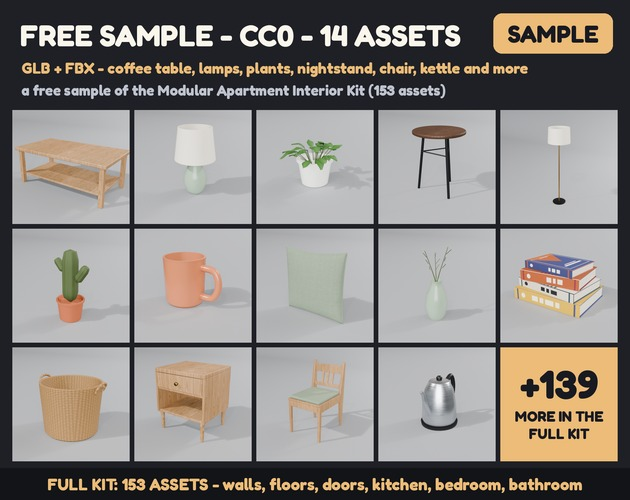

# Free Apartment Props (CC0): 14 low-poly interior models

Fourteen furniture and clutter models for games where you move into an apartment, clean it, decorate it or just live in it. Free and public domain, as GLB and FBX with PBR textures, ready for Godot, Unity, Unreal Engine, Blender and three.js. No credit needed, no email wall, commercial use is fine.



I built a whole kit for this kind of game, the [Modular Apartment Interior Kit](https://vuena.itch.io/modular-apartment-interior-kit), and I would like you to try the style before you decide. So here are 14 pieces from it. These are the same files as in the full kit, not cut-down versions.

## What is inside (14 models)

- **Living (6):** coffee table, table lamp, small potted plant, round side table, floor lamp, potted cactus.
- **Clutter (5):** mug, square cushion, vase with twigs, stack of books, wicker basket.
- **Bedroom (1):** nightstand (the drawer is a separate part, so it can slide).
- **Kitchen (2):** dining chair, kettle.

```
GLB/        14 .glb, one model per file, textures embedded (Living, Clutter, Bedroom, Kitchen)
FBX/        the same 14 models as .fbx (they read textures from ../../Textures, keep the layout)
Textures/   the 12 textures they use (1024 px at most: base colour, normal, roughness/metal)
Preview/    cover images
PACK-NOTES.txt
LICENSE     the CC0 1.0 legal text
LICENSE-FREE-SAMPLE-CC0.txt   the dedication that shipped inside the itch.io zip
```

14 GLB + 14 FBX + 12 textures. No skeletons and no animation clips.

## Using them

- **Godot 4:** drop a `.glb` into your project. The GLB files are self-contained.
- **Unity / Unreal Engine:** import the `.fbx` and keep the `Textures` folder in place. FBX cannot carry the packed roughness/metal maps (a Blender exporter limit), so use the GLB if you want everything.
- **Blender:** import the `.glb`.
- **three.js / Babylon.js:** load the `.glb` with GLTFLoader or SceneLoader.

Scale is 1 unit = 1 m. Every pivot is at the bottom centre, so a piece sits on the floor when you drop it at 0,0,0.

## Good to know

- I checked the files by script (scale, pivots, normals, UVs), but I have **not opened them in Unity, Unreal or the Godot editor**.
- Nothing carries a brand: the book covers are abstract.
- The pictures are renders. The lights and backdrop are not in the files.

## Licence

**CC0 1.0 Universal (public domain).** Use, change and share these 14 models freely, even commercially, with no credit and no need to ask me. The wood textures on the tables, nightstand and chair (`T_Oak*`, `T_Walnut`) are based on the Poly Haven photo texture [oak_veneer_01](https://polyhaven.com/a/oak_veneer_01) by Jenelle van Heerden, which is also CC0. The waiver covers only the files in this repo. The full kit has its own licence.

## Made by code, honestly

Every model is modelled by code in Blender, with Python scripts I wrote for these kits, and I wrote those scripts with AI help. There are no AI-generated meshes or textures.

## Want the rest?

The full **[Modular Apartment Interior Kit on itch.io](https://vuena.itch.io/modular-apartment-interior-kit)** has 153 models: modular walls on a 2 m grid, seven floors, doors, windows and stairs, plus a furnished living room, kitchen, bedroom, bathroom, kids room, home office and laundry, with doors and drawers that open. It comes with a two-storey demo apartment and a Godot 4 project. Buying it is what keeps me making these, and this free sample stays free either way.

- Free sample on itch: https://vuena.itch.io/modular-apartment-interior-kit-free
- Browse every model: https://models.popyca.com
- All packs (and the [Vuena All-in-1](https://vuena.itch.io/complete-collection)): https://vuena.itch.io
